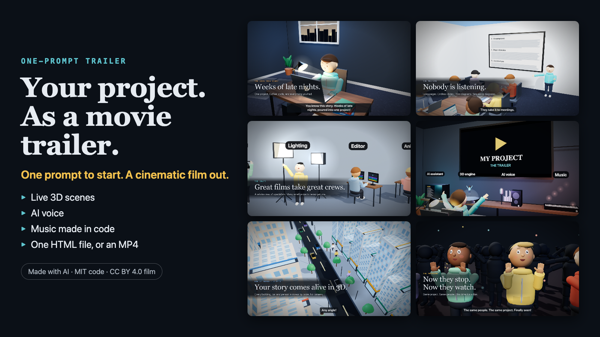
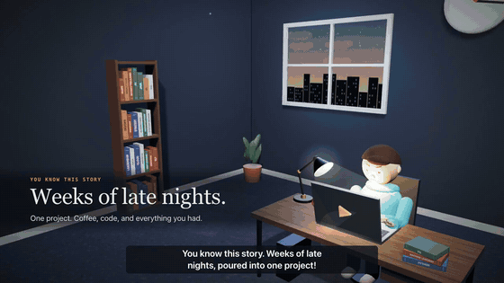

# 🎬 One-Prompt Trailer

> **Author:** Muhammad Akhtar Shamim · **Licence:** CC BY 4.0 (see LICENSE-MEDIA.md) · **Created:** 2026-11-21
>
> **What this file is:** The front page of the project: what it makes, how to watch the sample, how to make a trailer for your own project, how the parts fit together.

**Turn any project into a cinematic 3D trailer.** One prompt to start, your notes to finish: live 3D scenes, an AI
voice, music made in code, all in a single HTML file you can also export as a video.

## ▶️ Watch the sample

[](https://muhammadshamim.github.io/one-prompt-trailer/)

**[▶️ Play the full trailer with sound](https://muhammadshamim.github.io/one-prompt-trailer/)** · [🎞️ The video (MP4)](assets/trailer.mp4) · [📄 The single HTML file](docs/index.html)

A 129-second trailer about making trailers, built with this repository. The link plays it in your browser. Press Play
once: browsers need a click before they start sound.

**A few seconds of it, silent:**

[](https://muhammadshamim.github.io/one-prompt-trailer/)

---

## ✨ What you get

| | |
|---|---|
| 🧍 **A story with people** | A character who lives the problem, then the solution, in real rooms with real objects |
| 🎥 **Live 3D, many angles** | Every scene is drawn in the browser by code, with camera cuts inside each scene |
| 🗣️ **An AI voice** | Each phrase is spoken on the picture it belongs to |
| 🎹 **Original backing music** | Chords, drums, bass and melody synthesised note by note. No samples, no borrowed songs |
| 📄 **One file** | A single HTML page that plays in a modern browser, with chapters and a scrubber. It works offline and asks no other site for anything |
| 💬 **Captions** | Every spoken phrase shown as text, a transcript for screen readers, keyboard controls, and a subtitle file for the video |
| 🔢 **Honest numbers** | Figures shown in the film are counted from real files by a script, never typed |

## 🚀 Make one for your project

You need an AI coding assistant that can read and edit files. This was built and tested with
[Claude Code](https://claude.com/claude-code).

1. **Take the prompt and the sample trailer into your project.** Copy this repository into your own project as a
   folder named `trailer/`. The prompt, the sample film and the engine that builds it travel together.
2. **Open your project** in your assistant and **paste the prompt** from `trailer/PROMPT.md`.
3. **Direct it.** The assistant reads your project, shows you a plan, then builds one scene at a time. Tell it what
   to change.

The prompt tells the assistant to leave your own files alone and work only inside `trailer/`; your film is written
to `trailer/docs/index.html`.

> 💡 **Be ready to give feedback.** The sample film started from this prompt and then took many rounds of review:
> "too dark", "the screen faces the wrong way", "these words are out of sync". The rules in
> [`CLAUDE.md`](CLAUDE.md) and the skills in [`.claude/`](.claude) exist to make those rounds quick. One prompt
> starts the film; your eye finishes it.

## 🛠️ Build the sample yourself

Works on macOS with Python 3.12 and Node.js. Other systems need their own path to `espeak-ng` (see below).

```bash
brew install espeak-ng
python3.12 -m venv .venv
.venv/bin/pip install -r requirements.txt
python3 build.py
.venv/bin/python make_audio.py
python3 build.py
```

Every Python package version is pinned, and `vendor/package-lock.json` pins the two Node packages with their hashes.
Not pinned: your Python patch version, the operating system, `espeak-ng`, FFmpeg, the browser and graphics card that
record the video, and the voice model's files, which the voice tool downloads the first time it runs. So a rebuild
should sound and look the same, but is not guaranteed to match byte for byte. On an Apple-silicon Mac with Python 3.12 you can also install from
[`requirements.lock`](requirements.lock) with `pip install --require-hashes -r requirements.lock`, which checks each
package's file against a recorded hash. On another kind of machine, `make_lock.py` writes a lock file for it.

The last command prints something like `built docs/index.html  3106 KB  12 scenes  129 s  audio embedded`.

- **First run:** the voice model (Kokoro-82M, about 330 MB) downloads once.
- **Not on an Apple-silicon Mac?** Set `ESPEAK_LIB` and `ESPEAK_DATA` to where `espeak-ng` lives on your system.
- **Changed the spoken words?** Run `python3 tighten.py` first, and run the three build commands twice.
- **Want the poster?** `python3 make_poster.py` captures six frames of the film and lays them out.
- **Want a video?** `FFMPEG=/path/to/ffmpeg node make_video.js` records the film frame by frame into
  `assets/trailer.mp4` and cuts the silent preview. It needs Node.js 22 or later. Add `--width 1080 --height 1920`
  for a tall video, written beside the wide one as `assets/trailer-1080x1920.mp4`; upload `assets/trailer.srt` beside it for subtitles.
- **Another voice, language or pace?** `make_audio.py --voice <id> --lang <code> --pace 1.0`. Set `"language"` in
  `scenes.json` too, so the page declares it. The language codes the voice tool accepts are `en`, `en-gb`, `es`, `fr`,
  `hi`, `it`, `pt-br`, `ja` and `zh`; its model card lists the voices for each. **Only English with the voice
  `af_bella` has been built and checked here.** Write the film's lines in the language you choose first.

## 🧩 How it works

```text
scenes.json ──► build.py ──► audio/voice_script.json ──► make_audio.py ──► audio/track.mp3
     ▲                                                        │
     └──────────── tighten.py ◄── audio/audio_facts.json ◄────┘
scenes.json + src/ + vendor/ + audio/track.mp3 ──► build.py ──► docs/index.html
```

- **An assistant drafts, you decide.** Your project's files do not turn into a film by themselves: the AI assistant
  reads them, drafts the script and the scenes, and you approve or change each one.
- **The film is data.** `scenes.json` lists each scene: its words on screen, its spoken phrases and where in the
  scene each phrase belongs.
- **Each scene is one function** in `src/film.js` that builds its people and props and poses them for any moment.
  Because every frame depends only on the clock, you can jump anywhere and the picture is right.
- **The sound is computed.** `score.py` synthesises the music; the voice is generated locally; `make_audio.py`
  mixes them and checks that every phrase fits.
- **Pictures stay on their words.** `tighten.py` squeezes the silent gaps and writes a time-warp, so the film is as
  short as its words allow without anything drifting.

## 📁 What is in the box

| Path | What it is |
|---|---|
| [`PROMPT.md`](PROMPT.md) | The prompt to start your own trailer |
| [`CLAUDE.md`](CLAUDE.md) | The project's rules for the AI assistant: honesty, respect, rights, code standard |
| [`.claude/skills/`](.claude/skills) | Workflows: `trailer-build`, `trailer-scene`, `trailer-verify` |
| [`.claude/agents/`](.claude/agents) | Reviewers: `scene-reviewer`, `claims-checker` |
| [`scenes.json`](scenes.json) | The film as data |
| [`src/film.js`](src/film.js) | The engine and the twelve scenes |
| [`score.py`](score.py), [`make_audio.py`](make_audio.py) | The music and the voice |
| [`tighten.py`](tighten.py) | Shortens the film without breaking sync |
| [`build.py`](build.py) | Assembles the single page |
| [`make_poster.py`](make_poster.py) | Makes the poster from real frames |
| [`make_video.js`](make_video.js) | Records the film as an MP4 and cuts the README preview |
| [`docs/index.html`](docs/index.html), [`assets/trailer.mp4`](assets/trailer.mp4), [`assets/trailer.srt`](assets/trailer.srt) | The sample film as a page, as a video, and its subtitles |
| [`RIGHTS.md`](RIGHTS.md), [`THIRD-PARTY.md`](THIRD-PARTY.md) | Where every delivered file came from, and the licences of the parts that are not this project's |
| [`LICENSE`](LICENSE), [`LICENSE-MEDIA.md`](LICENSE-MEDIA.md) | MIT for the code; CC BY 4.0 for the film, poster, prompt and documents |
| [`vendor/`](vendor) | The Three.js bundle and the recipe that rebuilds it |

Every code file starts with a header saying what it does, how to run it, who wrote it and what changed.

## 🤝 Made with respect

- **For film-makers and musicians.** Great films take great crews, and real songs need real musicians. This is for
  the small project that would never have had a film at all.
- **For the truth.** The voice is synthetic and the music is generated; the film says so. It makes no price claims
  and no legal promises.
- **For other people's rights.** No recording, sample, song, photo or logo from anyone else is used. See
  [`THIRD-PARTY.md`](THIRD-PARTY.md).

## 🧰 Made with

**Claude Code** (the AI assistant) · **Three.js** (the 3D engine) · **Kokoro** (the AI voice) ·
**Python + NumPy** (the music) · **FFmpeg** (the sound mix)

These names belong to their owners; this project is not affiliated with or endorsed by them.

## 📜 Licence

© 2026 Muhammad Akhtar Shamim. Two licences, by kind of work:

| What | Licence | In short |
|---|---|---|
| 💻 The code (`.py`, `.js`, `.css`, `.html`, build and data files) | [MIT](LICENSE) | Use it, change it, share it; keep the notice |
| 🎬 The sample film, poster, prompt and documents | [CC BY 4.0](LICENSE-MEDIA.md) | Share and adapt it, also commercially; credit the author and say what you changed |

These licences make no claim on a film you make for your own project. They also give you no rights over what goes
into it: your project's material, confidential information, people's names and voices, and the tools you run keep
their own rights and terms. Have someone qualified check before you use a film commercially.

The project is not under one licence throughout: the tools it runs on keep their own licences ([`THIRD-PARTY.md`](THIRD-PARTY.md)), and
[`RIGHTS.md`](RIGHTS.md) records where every delivered file came from. Neither file is legal advice.
